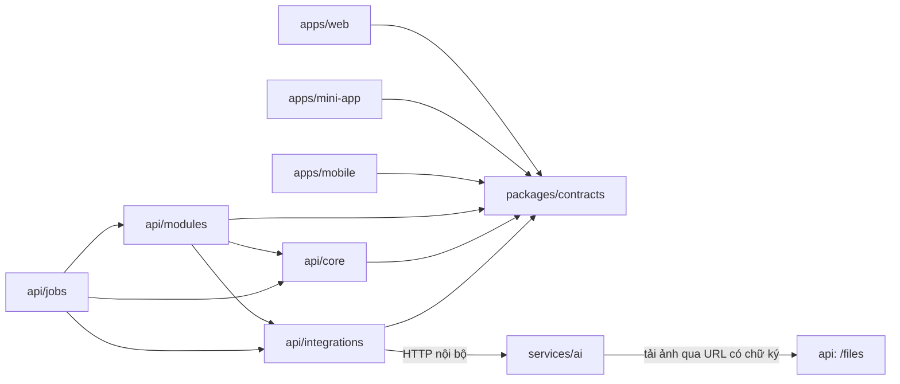
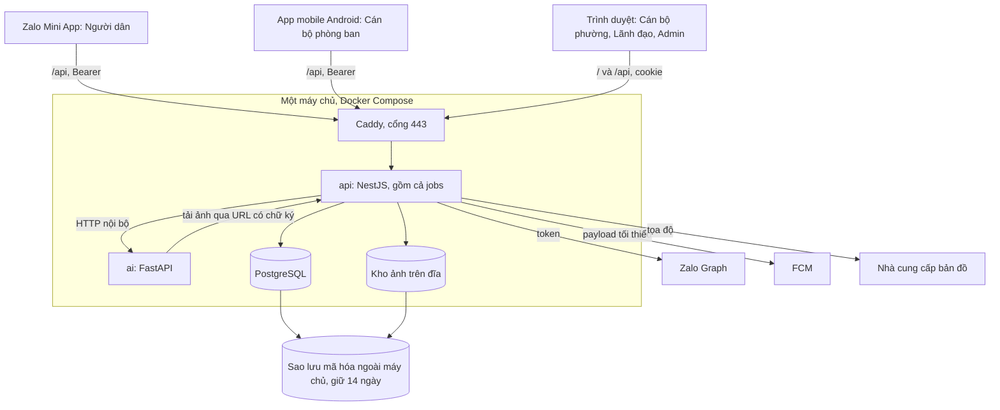
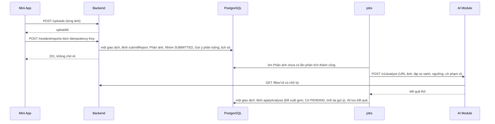
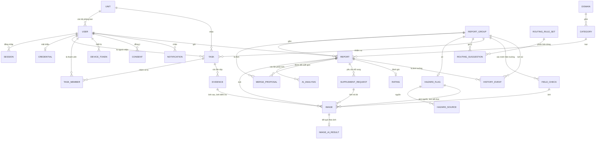

# Architecture Spine — WRMS

Tài liệu này chốt những điều mà 12 nhóm nghiệp vụ (12 epic) phải làm giống nhau. Thuật ngữ theo PRD §4. Phần **Invariants & Rules** và **Consistency Conventions** là ràng buộc. Phần **Stack** và **Structural Seed** là điểm xuất phát; khi đã có code thì code là nguồn đúng. `[ADOPTED]` là điều đã chốt ở PRD hoặc file chốt. `[ASSUMPTION]` là điều tài liệu này tự suy ra, chờ nhóm xác nhận. Lý do của từng quyết định nằm trong `.memlog.md` cùng thư mục.

## Design Paradigm

**Monolith mô-đun** cho backend, cộng **một dịch vụ suy luận AI không trạng thái**. Trong backend có ba ý chính:

- **Lõi vòng đời dùng chung.** Nhóm phản ánh là aggregate. Mọi thay đổi trên Phản ánh, Nhóm, Nhiệm vụ và Cờ nguy hại đi qua một module.
- **API chia theo đối tượng dùng.** Mỗi vai trò có một tiền tố route và một bộ schema đầu ra riêng.
- **Outbox giao dịch.** Lịch sử và thông báo được ghi trong cùng giao dịch với thay đổi; việc gửi ra ngoài do tác vụ quét làm sau.

| Tầng | Thư mục | Chứa |
| --- | --- | --- |
| Hợp đồng | `packages/contracts` | Schema zod của request và response, enum, mã lỗi, khóa setting, payload lịch sử và thông báo |
| Lõi | `apps/api/src/core` | `db`, `lifecycle`, `routing`, `history`, `notification`, `auth`, `scope`, `settings`, `storage`, `idempotency`, `calendar` |
| Tính năng | `apps/api/src/modules` | Controller và use case của từng nhóm nghiệp vụ, cùng các bảng riêng của nó |
| Tác vụ nền | `apps/api/src/jobs` | System Timer, gửi AI, đẩy thông báo, dọn, xóa |
| Tích hợp | `apps/api/src/integrations` | `zalo`, `ai`, `push`, `map` |
| Suy luận | `services/ai` | API, pipeline, đánh giá offline |
| Client | `apps/web`, `apps/mini-app`, `apps/mobile` | Giao diện; không có quy tắc nghiệp vụ |

Chiều phụ thuộc dưới đây là quy tắc. Mũi tên nghĩa là "được phép import hoặc gọi". Không có mũi tên thì không được.



Ba điều suy ra từ sơ đồ. Module tính năng không import module tính năng khác; thứ gì hai module cùng cần thì nằm trong `core`. `core` không import `modules` hay `integrations`. `services/ai` không biết tới DB. CI có một bước kiểm chiều import theo sơ đồ này.

## Invariants & Rules

### AD-1 — Backend giữ mọi quy tắc; một gói hợp đồng dùng chung `[ADOPTED: ba client, một backend]`

- **Binds:** mọi client; chot quyết định 8, 16 và mục 6; NFR-4, NFR-7; FR-1, FR-6, FR-7, FR-8
- **Prevents:** ba client tự cài quy tắc nghiệp vụ hoặc tự khai kiểu dữ liệu, rồi lệch nhau và lệch backend; hợp đồng với AI Module lệch mà không test nào báo.
- **Rule:**
  1. Quy tắc nghiệp vụ, chuyển trạng thái và kiểm quyền chỉ có ở `apps/api`. Client chỉ kiểm nhập liệu để báo lỗi sớm; backend luôn kiểm lại.
  2. Lệnh gửi phản ánh bị backend từ chối khi thiếu một trong các điều sau: đã đồng ý phiên bản nội dung hiện hành (FR-8); tài khoản có số điện thoại (FR-1); có Loại phản ánh đang hiển thị; có từ một ảnh tới số ảnh tối đa (FR-6); vị trí trong ranh giới (FR-7).
  3. `packages/contracts` là nơi duy nhất khai schema request và response, enum, mã lỗi, khóa setting, payload lịch sử và thông báo. Backend kiểm đầu vào và parse đầu ra bằng chính các schema đó. Client import kiểu từ gói này và không tự khai.
  4. Hợp đồng giữa backend và AI Module gồm schema trong `contracts` và model pydantic trong `services/ai`. Cả hai ở chế độ chặt: trường lạ là lỗi. Hai bên cùng chạy test trên một bộ fixture JSON trong repo; fixture có đủ mọi trường tùy chọn.
  5. Client coi giá trị enum lạ trong response là `UNKNOWN` và không dừng. Backend trả 426 với mã `APP_VERSION_TOO_OLD` cho app dưới phiên bản tối thiểu trong setting. Pull request nào thêm giá trị enum mà app mobile nhận được thì tăng phiên bản tối thiểu.

### AD-2 — API chia theo đối tượng dùng

- **Binds:** NFR-4; FR-22, FR-30, FR-31, FR-32, FR-42, FR-44, FR-55, FR-61, FR-62
- **Prevents:** một endpoint trả nhiều hình dạng theo vai trò; trường lọt sang vai trò không được xem (thông tin Nhiệm vụ tới Người dân, ảnh của Người gửi khác trong cùng Nhóm, Nhiệm vụ của đơn vị khác tới Cán bộ phòng ban).
- **Rule:**
  1. Mọi route nằm dưới `/api/v1`. Route nghiệp vụ nằm dưới đúng một tiền tố: `/resident` (Người dân), `/assignee` (Cán bộ phòng ban), `/officer` (Cán bộ phường và Lãnh đạo), `/admin` (Admin).
  2. Các tiền tố dùng chung là `/auth`, `/me`, `/config`, `/uploads`, `/files`, `/health`. Trừ `/files` trả chính file ảnh, chúng không trả dữ liệu phản ánh và không trả URL ảnh. Danh sách thông báo vì thế nằm dưới từng tiền tố đối tượng.
  3. Một guard toàn cục ánh xạ tiền tố sang vai trò và mặc định từ chối. Ba chỗ nằm ngoài guard vai trò: các route đăng nhập dưới `/auth`, `/files` (chỉ kiểm chữ ký, AD-14) và `/health`. Route không thuộc tiền tố nào làm ứng dụng không khởi động được.
  4. Mỗi tiền tố có schema đầu ra riêng trong `contracts`. Không có schema "đầy đủ" dùng chung giữa các tiền tố.
  5. Mỗi tiền tố có một hàm phạm vi dòng trong `core/scope`. Hàm đọc nào của tiền tố cũng nhận phạm vi làm tham số bắt buộc, không có giá trị mặc định. Dòng ngoài phạm vi trả 404.
  6. Phạm vi của resident: Phản ánh của chính mình; cộng ảnh kết quả của Nhóm khi Nhóm đã `COMPLETED` (ảnh Minh chứng đã duyệt của Đơn vị chủ trì, ảnh Kết thúc xử lý nguy hại). Không bao giờ gồm nội dung Phản ánh của người khác.
  7. Phạm vi của assignee: Nhiệm vụ mình là Người nhận hoặc thành viên Nhóm xử lý, kèm tên và vai trò (chủ trì hay phối hợp) của các Đơn vị khác trong cùng Nhóm, không kèm nội dung Nhiệm vụ của họ (FR-42). Nội dung của Nhóm (ảnh, mô tả, vị trí) chỉ có khi Nhiệm vụ đó còn mở; khi đã đóng chỉ còn dòng tóm tắt và Minh chứng của chính mình. `[ASSUMPTION]`
  8. Phạm vi của officer: mọi Nhóm. Riêng danh sách Nhiệm vụ: `WARD_OFFICER` thấy Nhiệm vụ của các Nhóm mình phụ trách (FR-22); `WARD_LEADER` thấy mọi Nhiệm vụ (FR-61).

### AD-3 — Lãnh đạo chỉ đọc bằng cấu trúc

- **Binds:** FR-61, NFR-4, FR-38, FR-41
- **Prevents:** sót kiểm quyền ghi ở một endpoint; thao tác xem của Lãnh đạo làm phát sinh mốc, số đo hoặc lịch sử.
- **Rule:**
  1. Guard toàn cục chỉ cho vai trò `WARD_LEADER` gọi GET và HEAD dưới `/officer`. Ngoài ra vai trò này chỉ dùng `/auth`, `/me`, `/config`.
  2. Handler GET của mọi tiền tố chạy trong giao dịch chỉ-đọc do `core/db` mở. GET không đổi dữ liệu nghiệp vụ, không ghi lịch sử, không ghi số đo. Việc ghi thời điểm hoạt động gần nhất của phiên do guard làm riêng, ngoài giao dịch này.
  3. Việc xem nào cần ghi lại là một lệnh POST riêng, áp cho mọi vai trò: ghi Mốc đã đọc (AD-20); ghi một lượt xem được đo vào `view_log`, gồm mở và đóng chi tiết Phản ánh của Cán bộ phường và lần đầu Người gửi mở phản ánh sau khi có kết quả (FR-38), mỗi lượt mang id do client sinh nên gửi lại không ghi trùng; mở lại dữ liệu đang ẩn, có ghi lịch sử (FR-41, AD-15); xuất CSV, có ghi lịch sử (FR-38).
  4. Hệ quả: Lãnh đạo không mở lại được dữ liệu ẩn, không xuất CSV, không sinh số đo. Web không hiện dải Cảnh báo đỏ và danh sách thông báo cho Lãnh đạo.

### AD-4 — Admin không chạm nội dung phản ánh

- **Binds:** NFR-4; PRD §8.1; FR-3, FR-4, FR-5, FR-57
- **Prevents:** tài khoản Admin (có thể do sinh viên giữ) đọc dữ liệu cá nhân của Người dân qua API quản trị; việc Admin tự tạo hoặc chiếm một tài khoản đọc được mà không ai biết.
- **Rule:**
  1. Vai trò `ADMIN` chỉ dùng `/admin`, `/auth`, `/me`, `/config`.
  2. Schema đầu ra của `/admin` không có mô tả, ảnh, vị trí, địa chỉ, Người gửi, bản đồ hay thống kê. Chỉ có danh mục, tài khoản, cấu hình và số đếm (số Nhiệm vụ đang mở của một cán bộ, số cán bộ của một Đơn vị).
  3. Quy tắc 1 và 2 chặn đường API quản trị. Chúng không chặn được việc Admin tạo tài khoản `WARD_OFFICER` hoặc `WARD_LEADER`, hay đặt lại mật khẩu của tài khoản đó, rồi đăng nhập bằng nó (FR-3 cho phép các thao tác này). Vì vậy: mọi lần tạo, mở khóa, đổi vai trò, đặt lại mật khẩu của hai loại tài khoản này ghi một sự kiện phạm vi `ACCOUNT`; mọi `WARD_OFFICER` và `WARD_LEADER` đọc được danh sách sự kiện đó; mật khẩu do Admin đặt phải được đổi ở lần đăng nhập đầu.

### AD-5 — Phiên phía server; một cơ chế cho ba client

- **Binds:** FR-1, FR-2, FR-3, NFR-5; chot mục 4; A6
- **Prevents:** ba cơ chế đăng nhập; phiên cũ còn sống sau khi Admin khóa tài khoản; đăng nhập sai nền tảng vẫn chạy.
- **Rule:**
  1. Phiên là một dòng trong bảng `session`. Token là chuỗi ngẫu nhiên; DB chỉ lưu giá trị băm. Mỗi request nạp phiên và tài khoản; tài khoản bị khóa hoặc phiên bị xóa thì trả 401 ngay.
  2. Mini App và mobile gửi `Authorization: Bearer`. Web dùng cookie `HttpOnly`, `Secure`, `SameSite=Strict`, cùng origin với API; request không phải GET từ web phải mang header `X-Client`.
  3. Mỗi phiên gắn với một loại client theo ánh xạ cố định, suy từ vai trò của tài khoản: `RESIDENT` với `mini_app`; `TASK_ASSIGNEE` với `mobile`; `WARD_OFFICER`, `WARD_LEADER`, `ADMIN` với `web`. Đăng nhập sai client trả mã `WRONG_PLATFORM` kèm tên nền tảng đúng. Header `X-Client` chỉ dùng để chống CSRF và để chọn thông báo lỗi; quyền không dựa vào nó.
  4. Băm mật khẩu, khóa đăng nhập sau nhiều lần sai và thời hạn phiên web theo các giá trị ở NFR-5; bộ đếm lần sai nằm trong DB. Thời hạn phiên mobile và Mini App là setting.
  5. Cán bộ không tự đăng ký và không tự khôi phục mật khẩu. Mobile lưu token trong secure storage. Mini App lưu bằng `nativeStorage`; mất token thì đăng nhập lại ngầm theo AD-6.

### AD-6 — Danh tính Zalo do backend xác thực

- **Binds:** FR-1; chot mục 4; quyết định 17
- **Prevents:** giả mạo ID Zalo; hai tài khoản cho một người.
- **Rule:**
  1. Mini App lấy access token bằng `getAccessToken` và gửi tới `POST /auth/zalo`. Use case này nằm ở `modules/accounts`: gọi `integrations/zalo` để lấy `id` từ Zalo Graph `/v2.0/me`, rồi gọi `core/auth` để tạo phiên.
  2. `id` đó là khóa của tài khoản Người dân và có ràng buộc duy nhất. Backend không nhận `id` do client tự gửi, kể cả giá trị từ `getUserID`.
  3. Token số điện thoại và token vị trí chỉ được đổi ở backend qua `/v2.0/me/info`. App secret chỉ có ở backend.
  4. Tài khoản được tạo ở lần đổi thành công đầu tiên, vai trò cố định là `RESIDENT`. Số điện thoại tự nhập (phương án dự phòng của FR-1) lưu kèm `phoneVerified = false`.
  5. Luồng ở quy tắc 1 chưa được chạy thử trên bản Development (điểm kiểm S0). Không có phương án dự phòng nào còn thỏa FR-1.

### AD-7 — Nhóm phản ánh là aggregate; `core/lifecycle` là nơi duy nhất ghi các bảng của nó

- **Binds:** PRD §4.1; FR-10, FR-14 đến FR-19, FR-22 đến FR-30, FR-43, FR-50 đến FR-53, FR-55, FR-56, FR-59; addendum (giao diện giữa các nhóm nghiệp vụ)
- **Prevents:** mỗi chủ epic tự cập nhật một cột trên cùng một dòng; sót hệ quả dây chuyền (Cờ làm Nhiệm vụ sang On Hold rồi Cancelled; gộp nhóm làm lan Cờ); Nhóm kẹt ở In Progress; hai cán bộ thao tác đè lên nhau; lệnh chạy trên Nhóm đã bị gộp đi.
- **Rule:**
  1. `core/lifecycle` là nơi duy nhất ghi mọi cột của `report`, `report_group`, `task`, `task_member`, `merge_proposal`, `hazard_flag`, `hazard_source`. Module tính năng và tác vụ nền chỉ đổi các bảng này qua lệnh có tên (danh sách ở Structural Seed).
  2. Ba máy trạng thái ở PRD §4.1 được cài một lần, dưới dạng bảng chuyển trong một file. Thêm một chuyển trạng thái là sửa file đó qua pull request do người sở hữu `core/lifecycle` duyệt.
  3. Mỗi lệnh có dạng `(tx, actor, input)`. Lệnh khóa dòng Nhóm bằng `FOR UPDATE` trước mọi việc khác; hai Nhóm thì khóa theo id tăng dần. Sau đó lệnh kiểm trạng thái và kiểm người thao tác theo cột "Ai" ở §4.1 (ví dụ chỉ Người nhận chấp nhận được Nhiệm vụ). Guard theo tiền tố chỉ kiểm vai trò. Lệnh cũng kiểm các điều kiện tiên quyết ghi ở phần Consequences của những FR nó hiện thực (ví dụ có Mức cuối trước khi giao, khóa giao việc khi Nhóm nguy hại, Hạn chót không ở quá khứ); mỗi điều kiện có một test từ chối.
  4. Mỗi lệnh kết thúc bằng một bước chung `settleGroup`. Bước này là nơi duy nhất xét hai chuyển trạng thái suy ra của Nhóm (Received sang In Progress, In Progress sang Completed), ghi Mốc đã trả lời công dân và chèn thông báo kết quả. Không lệnh nào tự cài hai chuyển trạng thái đó.
  5. Chuyển không hợp lệ trả 409 với mã `INVALID_STATE`.
  6. Phản ánh không có cột trạng thái: trạng thái của Phản ánh là trạng thái Nhóm của nó. Phản ánh bị từ chối được tách thành nhóm một phần tử ở `REJECTED`.
  7. Nhóm rỗng sau khi gộp chuyển sang trạng thái kết thúc `MERGED`, giữ `mergedIntoId`, không bị xóa, không hiện trong danh sách hay thống kê. Mọi lệnh trên nó trả 409 với mã `GROUP_MERGED`. `MERGED` là trạng thái kỹ thuật, không có Phản ánh nào mang nó.
  8. Gộp, tách và từ chối hủy các Đề xuất gom còn chờ đã mất hiệu lực vì thao tác đó.

### AD-8 — Bất biến đặt bằng ràng buộc DB; không xóa cứng dữ liệu gốc

- **Binds:** PRD §4 (Nhiệm vụ, Đơn vị chủ trì, Cờ nguy hại); FR-1, FR-3, FR-4, FR-5, FR-23, FR-45, FR-59
- **Prevents:** hai request đồng thời cùng qua được kiểm tra trong code và tạo bản ghi trùng; mỗi epic chọn một kiểu khóa ngoại và một kiểu xóa.
- **Rule:**
  1. Các bất biến sau là chỉ mục duy nhất trong schema, không chỉ là kiểm tra trong code: một Nhiệm vụ đang mở cho mỗi cặp Nhóm và Đơn vị; một Nhiệm vụ chủ trì đang mở cho mỗi Nhóm; một Cờ cho mỗi Nhóm; một tài khoản Người dân cho mỗi `id` Zalo; một đánh giá cho mỗi Phản ánh. Vi phạm trả 409 với mã `ALREADY_EXISTS`.
  2. "Đang mở" là một cột do lifecycle duy trì theo định nghĩa ở PRD §4, gồm cả Declined chưa xét.
  3. Nhiệm vụ chủ trì chỉ thuộc Đơn vị ở chế độ `IN_SYSTEM` (FR-59).
  4. Không xóa cứng dòng của `user`, `unit`, `domain`, `category`. Chúng chỉ bị khóa hoặc ẩn bằng một cột thời điểm. Mọi khóa ngoại dùng `RESTRICT`.

### AD-9 — Lịch sử chỉ-thêm, ghi cùng giao dịch

- **Binds:** FR-31, FR-35, FR-37, FR-38, FR-41, FR-57, FR-62
- **Prevents:** mỗi module ghi log một kiểu hoặc quên ghi; dòng thời gian của một Phản ánh đứt khi gộp hoặc tách nhóm; số liệu dashboard không tính lại được; dữ liệu cá nhân còn sót trong lịch sử sau khi xóa.
- **Rule:**
  1. Có một bảng `history_event`. Chỉ `core/history` chèn, trong giao dịch của thay đổi. Một trigger DB (migration viết tay) chặn UPDATE và DELETE.
  2. Mỗi sự kiện có loại, phạm vi (`CASE`, `CONFIG`, `ACCOUNT`), tác nhân (một tài khoản, `SYSTEM` hoặc `AI`), thời điểm và payload. Payload của từng loại là một schema trong `contracts`; `core/history` parse khi chèn.
  3. Mọi sự kiện phạm vi `CASE` liệt kê id Nhóm và id của mọi Phản ánh bị ảnh hưởng. Dòng thời gian của một Phản ánh và số liệu của một Nhóm là truy vấn trên cùng các sự kiện đó.
  4. Payload chỉ chứa id, mã và giá trị trạng thái. Không chứa mô tả, tọa độ chính xác, địa chỉ, số điện thoại, tên Người gửi hay khóa file.
  5. Gợi ý của AI và quyết định của người là hai sự kiện và hai cột riêng; không bên nào ghi đè bên nào.
  6. Số liệu ở FR-37 và FR-38 là truy vấn trên bảng hiện tại và lịch sử. Không lưu bộ đếm riêng.

### AD-10 — Thông báo: dòng trong DB là nguồn chính, đẩy là phụ

- **Binds:** FR-3, FR-32, FR-33, FR-34, FR-44, FR-51, FR-63; NFR-6, NFR-8; A3; chot quyết định 9
- **Prevents:** đẩy trước khi giao dịch commit, hoặc mất khi tiến trình chết; module gọi thẳng SDK đẩy; một thao tác sinh nhiều thông báo; nội dung thông báo giữ dữ liệu cá nhân ngoài tầm xóa hoặc đi qua máy chủ bên ngoài.
- **Rule:**
  1. Thông báo là một dòng trong bảng `notification`. Chỉ `core/notification` chèn, trong giao dịch của lệnh sinh ra nó. Mỗi lần chạy lệnh sinh nhiều nhất một dòng cho mỗi cặp người nhận và loại thông báo. Loại "trạng thái phản ánh đổi" mang trạng thái cuối của lệnh, nên Nhóm đi qua hai trạng thái trong một lệnh chỉ sinh một dòng loại này.
  2. Dòng chỉ chứa loại (enum trong `contracts`), id đối tượng và tham số có kiểu gồm id và mã. Dòng không chứa câu chữ, tên, địa chỉ hay khóa file. Câu chữ và URL ảnh được dựng lúc đọc, bởi endpoint của từng tiền tố.
  3. Danh sách thông báo và số chưa đọc ở cả ba client đọc bảng này.
  4. Đẩy là việc giao lại dòng đó do tác vụ quét làm (AD-13), theo kiểu ít nhất một lần: gửi xong mới ghi `pushedAt`. Client bỏ trùng theo id thông báo. Đẩy lỗi không ảnh hưởng dòng.
  5. Ở v1 chỉ đẩy tới app mobile của Cán bộ phòng ban, qua FCM. Payload chỉ gồm id thông báo, loại, id đối tượng và một tiêu đề cố định theo loại. Loại "Nhiệm vụ chuyển On Hold" dùng tiêu đề an toàn cố định và mức ưu tiên cao của FCM (FR-33).
  6. `device_token` lưu token FCM gốc của máy, lấy bằng `getDevicePushTokenAsync`. Mỗi token là duy nhất, gắn lại khi đăng nhập, bị xóa khi đăng xuất, khi tài khoản bị khóa, hoặc khi FCM báo token hết hiệu lực.
  7. Người dân chỉ có thông báo trong Mini App. Cán bộ phường chỉ có thông báo trên web. Thông báo "cần xử lý" của Cán bộ phường (FR-34) hiển thị theo trạng thái của đối tượng, không theo cờ đã đọc.
  8. Cảnh báo đỏ không phải dòng thông báo: web hỏi định kỳ danh sách Cờ đang `PENDING`.

### AD-11 — AI Module không trạng thái; backend giữ mọi trạng thái `[ADOPTED: dịch vụ riêng, không gọi AI API ngoài]`

- **Binds:** FR-9, FR-10, FR-11, FR-50, FR-60; NFR-8; PRD §5.3, §6; addendum (Hướng kỹ thuật cho AI Module); chot quyết định 22
- **Prevents:** hai nơi cùng giữ trạng thái gom nhóm; AI Module ghi vào DB nghiệp vụ; bản sao ảnh hoặc vector nằm ngoài tầm xóa của FR-41; phạm vi AI theo Lĩnh vực bị viết cứng ở hai nơi; logic gom nhóm khi chạy thật khác logic được đánh giá.
- **Rule:**
  1. AI Module chỉ có `POST /v1/analyze` và `GET /health`, chỉ nghe trên mạng nội bộ. Nó không có DB, không giữ ảnh hay vector giữa hai request, không đọc DB của backend, và không gọi backend ngoài việc tải ảnh qua URL có chữ ký (AD-14) nằm trong request.
  2. Request mang: dữ kiện của Phản ánh; URL ảnh; tập so sánh do backend chọn; các ngưỡng lấy từ setting; và hai cờ phạm vi do backend tính từ cấu hình: có so ảnh khi gom không (Lĩnh vực có AI ảnh), có nhận diện loại rác không, gồm cả nhãn nguy hại và y tế (Lĩnh vực thí điểm). Sàng lọc và Nhãn ảnh chạy cho mọi Phản ánh. AI Module không chứa mã Lĩnh vực nào.
  3. Tập so sánh gồm các Nhóm đang mở trong một bán kính thô, kèm Loại phản ánh, vị trí, thời điểm và dấu vân tay ảnh; cộng mã băm gọn của mọi ảnh chưa ẩn để kiểm "lặp lại".
  4. Response mang kết quả thô. Theo từng ảnh: cờ sàng lọc với đúng một lý do, các nhãn kèm độ tin cậy, dấu vân tay kèm phiên bản. Theo Phản ánh: Mức gợi ý kèm loại rác phát hiện được, và nhiều nhất một Nhóm đích kèm điểm. Kèm theo là phiên bản model và thời gian xử lý.
  5. Toàn bộ logic sàng lọc, gom nhóm, nhãn và Mức gợi ý nằm trong `services/ai/pipelines`, dùng chung cho API và cho đánh giá offline.
  6. Dấu vân tay khác phiên bản bị coi như không có. Hệ quả: sau khi đổi model, ảnh cũ không còn được so "lặp lại" và so khi gom cho tới khi được tính lại (Deferred).
  7. Gợi ý sửa Loại phản ánh theo Nhãn ảnh (FR-60) không được lưu. Schema đầu ra của `/officer` suy ra nó lúc đọc, từ Nhãn ảnh đã lưu và ngưỡng trong setting. Nó không là đầu vào của phân luồng.

### AD-12 — AI chạy ngoài request; kết quả đến muộn không đè quyết định của người

- **Binds:** FR-6, FR-12, FR-13; NFR-1, NFR-2, NFR-9; PRD §8.2
- **Prevents:** việc gửi phản ánh treo theo AI; mất việc phân tích khi backend khởi động lại; kết quả AI đến sau rơi vào một Nhóm đã bị gộp, từ chối hoặc xóa, hoặc ghi đè Mức cuối và quyết định gom.
- **Rule:**
  1. Lệnh gửi phản ánh không gọi AI Module và không ghi dòng `ai_analysis` nào. Tác vụ quét tìm Phản ánh chưa có lần phân tích thành công, tạo một lần thử, gọi AI Module, lưu kết quả hoặc lỗi kèm thời điểm bắt đầu và kết thúc.
  2. Nhãn "đang phân tích" và "chưa phân tích" được suy ra từ các lần thử và thời hạn trong setting. Không lưu cờ riêng.
  3. Lần thử lỗi hoặc quá hạn được thử lại có giãn cách chừng nào Nhóm của Phản ánh còn ở `SUBMITTED` (FR-12).
  4. Khi có kết quả, tác vụ mở một giao dịch: lệnh lifecycle `applyAnalysis` chạy trước, rồi `modules/analysis` lưu kết quả và đánh dấu lần thử đã áp. Lệnh khóa Nhóm hiện tại và Nhóm đích. `modules/analysis` chỉ đưa vào lệnh lần thử mới nhất, chưa áp, của mỗi Phản ánh.
  5. `applyAnalysis` chỉ tạo Đề xuất gom khi Phản ánh còn một mình trong một Nhóm `SUBMITTED` và Nhóm đích còn mở. Nó chỉ tạo Cờ `PENDING` trên Nhóm đang mở. Nó không đổi Mức cuối, không mở lại Đề xuất gom đã quyết, và chỉ đổi Cờ theo quy tắc "nguồn mới" ở FR-51.

### AD-13 — Tác vụ nền: quét trạng thái DB, một cơ chế

- **Binds:** FR-39, FR-40, FR-41, FR-63, FR-12, FR-59, FR-34; NFR-6
- **Prevents:** ba chủ epic chọn ba cơ chế chạy nền; timer trong bộ nhớ mất khi khởi động lại; nhắc trùng; tác vụ nền và lệnh của người dùng cùng sửa một Nhiệm vụ.
- **Rule:**
  1. Mọi việc nền là tác vụ quét định kỳ trong `apps/api/src/jobs`, chạy trong tiến trình backend: nhắc Nhiệm vụ chưa đọc, nhắc sắp quá hạn, báo quá hạn, báo Nhiệm vụ phối hợp ngoài hệ thống quá hạn, gửi AI, đẩy thông báo, dọn ảnh tải lên chưa gắn, xóa dữ liệu hết hạn.
  2. Mỗi tác vụ suy việc cần làm từ dữ liệu trong DB. Không dùng timer hay hàng đợi trong bộ nhớ, không thêm broker.
  3. Tác vụ không ghi thẳng bảng của ai. Việc trên một Nhiệm vụ hoặc Nhóm là một lệnh lifecycle: lệnh khóa Nhóm rồi kiểm lại điều kiện bên trong khóa. Việc trên bảng khác đi qua hàm của chủ bảng.
  4. Dấu đã nhắc do lifecycle giữ trên Nhiệm vụ: giá trị Hạn chót đã nhắc sắp quá hạn và đã báo quá hạn (một lần cho mỗi Hạn chót); thời điểm đã nhắc chưa đọc (một lần cho mỗi Nhiệm vụ); và `readClockStartedAt`, đặt khi giao và đặt lại khi Nhiệm vụ trở về `ASSIGNED` sau On Hold.
  5. Quá hạn và sắp quá hạn là vị từ tính từ Hạn chót, trạng thái và thời điểm hiện tại. Nhãn "quá hạn đọc" là vị từ: đã nhắc chưa đọc, chưa có Mốc đã đọc, và còn ở `ASSIGNED`. Không có cột cờ nào cho ba nhãn này.
  6. Tác vụ chạy theo ba bước: một giao dịch ngắn nhận việc, có `pg_try_advisory_xact_lock` với id khai trong một enum ở `jobs/`; lời gọi ra ngoài (AI, FCM) nếu có, nằm ngoài mọi giao dịch (AD-25); một giao dịch ghi kết quả. Tác vụ ghi lần chạy gần nhất vào `job_run`.
  7. Quy tắc theo giờ (khung giờ đêm, ngày làm việc) tính theo múi giờ `Asia/Ho_Chi_Minh`.

### AD-14 — Ảnh: một đường tải lên, một đường tải xuống có chữ ký

- **Binds:** NFR-5, NFR-7, NFR-10; FR-6, FR-15, FR-20, FR-21, FR-29, FR-30, FR-51, FR-52, FR-55; A4
- **Prevents:** đường dẫn ảnh công khai; mỗi client một kiểu tải lên; ảnh nằm trong JSON hoặc trong DB; bản sao ảnh ngoài tầm xóa; một tài khoản Zalo làm đầy đĩa máy chủ.
- **Rule:**
  1. Tải lên qua `POST /uploads`, mỗi request một ảnh, cần phiên. Backend kiểm loại bằng nội dung file, kiểm dung lượng, mã hóa lại và bỏ metadata, lưu vào kho riêng tư dưới khóa ngẫu nhiên, rồi trả `uploadId`.
  2. Lệnh nghiệp vụ tham chiếu `uploadId` của chính người gọi, chưa gắn vào đâu. Ảnh chưa gắn bị dọn sau một thời hạn trong setting, không ngắn hơn thời gian client giữ bản nháp; dùng `uploadId` đã bị dọn trả mã `UPLOAD_EXPIRED`.
  3. `/auth` và `/uploads` có giới hạn tần suất. Mỗi tài khoản có hạn mức số ảnh và dung lượng tải lên mỗi ngày, đặt trong setting.
  4. Ảnh "chụp trực tiếp" mang thời điểm chụp, tọa độ và nguồn (`CAMERA` từ app mobile, `WEB_CAPTURE` từ web) do client khai lúc tải lên. Backend luôn ghi thêm thời điểm nhận. Minh chứng và báo chất thải nguy hại từ mobile chỉ nhận nguồn `CAMERA`.
  5. Tải xuống chỉ qua `GET /files/:id` kèm hạn và chữ ký HMAC trên id ảnh, hạn và cờ mở lại. Route này không kiểm phiên: nó kiểm chữ ký, hạn, và việc ảnh chưa bị xóa. Ảnh đang ẩn hoặc bị loại chỉ tải được bằng URL có cờ mở lại, do lệnh mở lại dữ liệu ẩn cấp với hạn rất ngắn (AD-15).
  6. URL do schema đầu ra cấp sau khi qua phạm vi dòng của người xem (AD-2), sống ngắn theo setting. Ai có URL còn hạn thì tải được. URL trong response và trong request gửi AI Module là đường dẫn tương đối; mỗi bên tự ghép địa chỉ gốc của mình.
  7. Reverse proxy không phục vụ thư mục kho. Client nén ảnh về tối đa 2 MB trước khi tải; backend vẫn áp giới hạn riêng.
  8. Ở v1 kho ảnh là một thư mục trên đĩa của máy chủ, đứng sau một bộ hàm duy nhất trong `core/storage`.

### AD-15 — Ẩn theo trường, xóa theo chủ dữ liệu, sao lưu có hạn

- **Binds:** FR-41, FR-15, FR-17, FR-8, FR-31, FR-36, FR-37; NFR-11; PRD §8.1
- **Prevents:** dữ liệu đã ẩn vẫn hiện ở một đường đọc; Phản ánh bị từ chối biến mất khỏi danh sách của Người gửi và khỏi thống kê; tác vụ xóa bỏ sót một bản sao; khôi phục sao lưu làm sống lại dữ liệu đã xóa.
- **Rule:**
  1. Ẩn là đặt `hiddenAt` và `purgeAfter` trên Phản ánh bị từ chối và ảnh bị loại; số ngày giữ là setting, mặc định 90. Lifecycle đặt trên Phản ánh, và gọi hàm của `core/storage` để đặt trên ảnh.
  2. Ẩn theo trường, không theo dòng. Dòng vẫn nằm trong mọi phạm vi. Schema đầu ra của mọi tiền tố để trống các trường ẩn: ảnh, mô tả, tọa độ chính xác, địa chỉ. Loại phản ánh, Khu vực, lý do từ chối và các thời điểm vẫn hiển thị.
  3. Mở lại dữ liệu ẩn (FR-41) là lệnh `revealHidden` của lifecycle, chỉ cho `WARD_OFFICER`, có ghi một sự kiện lịch sử. Lệnh không lưu trạng thái: các trường ẩn và URL ảnh có cờ mở lại chỉ có trong response của chính lệnh POST đó, không có trong GET nào sau đó.
  4. Ảnh đang ẩn không vào tập so sánh gửi AI.
  5. Xóa theo chủ dữ liệu. Module nào giữ chữ tự do, vị trí hoặc file sinh ra từ một Phản ánh thì có một hàm xóa cho Phản ánh đó. Tác vụ xóa gọi mọi hàm ấy khi tới `purgeAfter`. Danh sách hiện có: mô tả, tọa độ chính xác và địa chỉ; file ảnh; câu trả lời Yêu cầu bổ sung; kết quả thô và dấu vân tay AI; lý do trong Gợi ý phân luồng. Tác vụ ghi một sự kiện lịch sử chỉ có id và chạy lại nhiều lần vẫn cho cùng kết quả.
  6. Bản ghi idempotency và dòng thông báo chỉ chứa id, mã và trạng thái, nên không cần xóa.
  7. Sao lưu gồm một bản dump PostgreSQL và một bản chụp kho ảnh mỗi ngày, có mã hóa, đặt ở một nơi ngoài máy chủ, giữ đúng 14 ngày rồi hủy. Dữ liệu đã xóa vì thế rời khỏi mọi bản sao lưu chậm nhất 14 ngày sau khi xóa.
  8. Khi khôi phục: nạp DB và kho ảnh, chạy tác vụ xóa, rồi mới mở API. Nhóm chạy thử khôi phục một lần trước thí điểm (NFR-11).
  9. Không có bản sao nào khác của dữ liệu thật: không chép sang máy dev, không xuất ảnh. Tệp xuất (FR-38) không chứa nội dung đang ẩn hoặc đã xóa; số đếm và các trường còn giữ thì có. `[ASSUMPTION: ảnh của phản ánh thật không dùng để huấn luyện hay đánh giá cho tới khi phường trả lời PRD §14 câu 10]`

### AD-16 — Cấu hình: mỗi giá trị đúng một nơi

- **Binds:** PRD §2.1; FR-4, FR-5, FR-7, FR-8, FR-13, FR-23, FR-39, FR-41, FR-57, FR-60, FR-63; NFR-2; chot quyết định 12, 14, 15, 24
- **Prevents:** giá trị đang chờ phường trả lời bị viết cứng trong code hoặc ở ba client; cùng một giá trị có hai nguồn; hai người đặt hai tên cho cùng một khóa setting.
- **Rule:**
  1. Có ba nơi, và mỗi giá trị thuộc đúng một nơi.
  2. Bảng danh mục, Admin sửa được: Lĩnh vực, Loại phản ánh, Đơn vị xử lý và chế độ, bộ quy tắc phân luồng (AD-18).
  3. Bảng `setting`, Admin sửa được: Hạn chót mặc định, lịch ngày làm việc, mốc nhắc sắp quá hạn, Hạn đọc, khung giờ đêm, bán kính lân cận, số ngày giữ dữ liệu ẩn, số tháng giữ phản ánh khác, các ngưỡng AI, thời hạn và giãn cách thử lại của phân tích AI, số ảnh tối đa, hạn mức tải lên, thời hạn giữ ảnh chưa gắn, hạn của URL ảnh, nội dung đồng ý và phiên bản, thời hạn phiên, phiên bản app tối thiểu, chu kỳ của từng tác vụ quét.
  4. Cấu hình triển khai, không sửa qua giao diện: mã Lĩnh vực thí điểm, mã hai Lĩnh vực có AI ảnh, secret, file ranh giới, nguồn bản đồ.
  5. Khóa setting và schema giá trị của từng khóa là một bảng zod trong `contracts`. `core/settings` kiểm khi đọc và khi ghi; khóa lạ làm ứng dụng không khởi động được.
  6. Giá trị mặc định lấy từ PRD §2.1 và `de-xuat-phan-luong-2026-10-29.md` §2 và §3, đặt trong `config/seed`. Seed chạy lại được và không ghi đè giá trị đã sửa.
  7. Code backend đọc qua `core/settings`. Client lấy qua `/config`, là một phép chiếu theo vai trò khai trong `contracts`. Không nơi nào chứa hằng số của các giá trị này.
  8. Mỗi lần sửa danh mục hoặc setting ghi một sự kiện lịch sử phạm vi `CONFIG`. Hai người sửa cùng lúc thì lần ghi sau thắng.

### AD-17 — Ranh giới và Khu vực: một file, backend phán quyết

- **Binds:** FR-7, FR-36, FR-37, FR-41; PRD §4 (Khu vực); chot quyết định 20
- **Prevents:** ba client dùng ba bản ranh giới; client cho gửi nhưng backend từ chối, hoặc ngược lại.
- **Rule:**
  1. `config/boundary.geojson` là một FeatureCollection có đúng ba feature, mang mã `HOA_XUAN`, `HOA_CHAU`, `HOA_PHUOC`, không chồng lên nhau. Ranh giới phường là hợp của ba. CI kiểm file này.
  2. Khi gửi, backend gán `areaCode` từ tọa độ và từ chối vị trí ngoài ranh giới; đây là kết luận duy nhất có hiệu lực. Điểm nằm trên cạnh chung nhận mã đứng trước theo thứ tự chữ cái.
  3. Client lấy chính file này qua `/config` để kiểm trước và để vẽ; client không đóng gói bản riêng.
  4. Tọa độ theo WGS84, lưu ở hai cột số `lat` và `lng`. Phép chứa và khoảng cách tính trong code backend.

### AD-18 — Phân luồng là hàm thuần trong `core/routing` `[ADOPTED]`

- **Binds:** FR-57, FR-58, FR-59; SM-R6; addendum (Phân luồng)
- **Prevents:** phân luồng trôi vào AI Module hoặc vào client; gợi ý ngừng chạy khi AI lỗi; gợi ý không được tính lại vì không module nào được phép gọi; việc sửa bảng quy tắc làm đổi Nhóm đã tiếp nhận.
- **Rule:**
  1. `core/routing` có một hàm thuần. Đầu vào là dữ kiện của Nhóm (Lĩnh vực, các Loại phản ánh, mô tả đã chuẩn hóa, giờ gửi, trạng thái Cờ) và một bộ quy tắc. Đầu ra là Đơn vị chủ trì, các Đơn vị phối hợp và lý do. Nhãn ảnh không phải đầu vào. Hàm được kiểm bằng bảng test.
  2. Bộ quy tắc là một tài liệu có phiên bản: Đơn vị chủ trì mặc định của từng Lĩnh vực và danh sách quy tắc phối hợp, kiểm bằng schema trong `contracts`. Mỗi lần Admin sửa tạo một phiên bản mới; phiên bản cũ không đổi. Danh mục từ chối việc đặt một Đơn vị `EXTERNAL` làm chủ trì mặc định, và từ chối đổi một Đơn vị đang là chủ trì mặc định sang `EXTERNAL`.
  3. Chỉ lifecycle gọi hàm này, trong các lệnh làm đổi đầu vào: gửi phản ánh, áp kết quả AI, gộp, tách, sửa Loại phản ánh, đổi trạng thái Cờ.
  4. Nhóm ghi lại phiên bản bộ quy tắc tại lúc tiếp nhận. Mọi lần tính lại sau đó dùng phiên bản ấy (FR-57).
  5. Gợi ý lưu trong `routing_suggestion`. Danh sách đơn vị cuối cùng không lưu riêng: đó là tập Đơn vị của các Nhiệm vụ đã tạo cho Nhóm (SM-R6). Chế độ của Đơn vị được chép vào Nhiệm vụ lúc tạo; Nhiệm vụ `EXTERNAL` đi đường rút gọn của FR-59 trong lifecycle.
  6. "Giờ gửi" ở mọi nơi (phân luồng, thứ tự Hàng chờ, thống kê) là thời điểm backend nhận lệnh gửi. Thời điểm do client khai lưu riêng và chỉ để tham khảo.

### AD-19 — Lệnh gửi lại được phải idempotent; bản nháp chỉ ở trên máy

- **Binds:** NFR-10; FR-6, FR-21, FR-29, FR-42, FR-51; A5
- **Prevents:** phản ánh hoặc Minh chứng bị tạo hai lần khi mạng chập chờn; bản nháp bị từ chối một lần rồi không bao giờ gửi lại được; mỗi client tự định nghĩa "nháp" trên server.
- **Rule:**
  1. Bốn lệnh mang header `Idempotency-Key` do client sinh: gửi phản ánh, nộp Minh chứng, báo chất thải nguy hại, trả lời Yêu cầu bổ sung.
  2. Khóa là duy nhất theo bộ ba tài khoản, lệnh, khóa. Bản ghi lưu mã băm của request và id của đối tượng đã tạo. Chỉ lệnh thành công mới được ghi.
  3. Khi nhận lặp, backend đọc lại đối tượng đó qua schema đầu ra thường lệ. Cùng khóa nhưng khác mã băm trả 409 với mã `IDEMPOTENCY_KEY_REUSED`. Việc kiểm khóa chạy trước việc kiểm trạng thái.
  4. Bản nháp chỉ tồn tại trên máy; backend không có khái niệm nháp. Khi gửi lại, client tải ảnh trước rồi mới gửi lệnh.
  5. Backend là nơi kết luận một lệnh đã cũ: nộp Minh chứng cho Nhiệm vụ ở `ON_HOLD` hoặc `CANCELLED` trả 409 kèm mã. App giữ nháp và báo lý do; lần gửi sau dùng lại được cùng khóa vì lỗi không được ghi.
  6. Chỉ hai luồng có hàng đợi gửi lại: gửi phản ánh trên Mini App và nộp Minh chứng trên mobile.

### AD-20 — Mốc theo dõi: lưu một chỗ, phần còn lại suy ra

- **Binds:** FR-62, FR-63, FR-42, FR-22, FR-37, FR-21
- **Prevents:** danh sách của Cán bộ phường, màn hình của Lãnh đạo và thống kê tính mốc theo ba cách; một trạng thái lưu riêng không ai đóng được.
- **Rule:**
  1. Mốc đã đọc là `task.readAt`, ghi một lần, chỉ bởi lifecycle: lệnh `markTaskRead` khi Người nhận mở chi tiết trên mobile (`POST /assignee/tasks/:id/read`), hoặc các lệnh chấp nhận, từ chối, báo chất thải nguy hại khi người thao tác là Người nhận và mốc còn trống.
  2. Thông báo đẩy tới máy và việc đánh dấu đã đọc ở danh sách thông báo không ghi mốc.
  3. Mốc đã xử lý không được lưu: đó là thời điểm của lần nộp Minh chứng gần nhất, chỉ hiển thị khi Nhiệm vụ ở `SUBMITTED` hoặc `APPROVED`.
  4. Mốc đã trả lời công dân là `group.citizenAnsweredAt`, do `settleGroup` ghi trong chính giao dịch chèn thông báo kết quả cho mọi Người gửi khi Nhóm sang `COMPLETED` hoặc `CLOSED`. `[ASSUMPTION: "đã gửi" nghĩa là dòng thông báo đã được lưu, vì v1 không đẩy tới Người dân]`
  5. Yêu cầu bổ sung không có cột trạng thái. Nó "đang mở" khi chưa có câu trả lời và Nhóm của Phản ánh đang ở `RECEIVED` hoặc `IN_PROGRESS`.

### AD-21 — Bản đồ: một họ thư viện; geocode qua backend

- **Binds:** FR-7, FR-36, FR-42; NFR-8
- **Prevents:** ba client dùng ba SDK và ba khóa bản đồ; client gửi dữ liệu ra dịch vụ ngoài mà backend không biết.
- **Rule:**
  1. Web và Mini App dùng MapLibre GL JS; mobile dùng MapLibre React Native.
  2. Nguồn bản đồ là một giá trị trong cấu hình triển khai. `/config` trả một mô tả gồm kiểu (`vector-style` hoặc `raster-tiles`), URL và dòng ghi công. Bản đồ bị giới hạn trong khung của phường.
  3. Việc đổi tọa độ thành địa chỉ chỉ do `integrations/map` của backend gọi; kết quả được lưu vào Phản ánh lúc gửi. Dịch vụ lỗi thì địa chỉ để trống và việc gửi vẫn thành công.
  4. Client không gọi thẳng API geocode nào. Chỉ tọa độ rời hệ thống.

### AD-22 — Biên mạng và luồng ra ngoài

- **Binds:** NFR-5, NFR-8; chot mục 4; PRD §8.1
- **Prevents:** dịch vụ nội bộ lộ ra Internet; cookie của cán bộ bị dùng từ origin của Mini App; dữ liệu phản ánh rời máy chủ ngoài ba luồng đã biết.
- **Rule:**
  1. Chỉ reverse proxy mở cổng ra ngoài, và chỉ HTTPS: `/` là web, `/api` là backend. AI Module, PostgreSQL và kho ảnh chỉ nghe trên mạng nội bộ của Compose.
  2. CORS chỉ cho origin của Mini App và không bật credentials. Quyền chỉ đến từ Bearer token, vì nhiều Mini App của Zalo có thể dùng chung một origin. `[ASSUMPTION: origin thật chờ điểm kiểm S5]`
  3. Backend chỉ gọi ra ba nơi: Zalo Graph (token), FCM (payload theo AD-10), nhà cung cấp bản đồ (tọa độ).
  4. Log không ghi mô tả, số điện thoại, tọa độ, token, hay query của `/files`.

### AD-23 — Giấy phép của model và thư viện AI

- **Binds:** NFR-8; PRD §1 (mục tiêu phường dùng thật), §6; addendum (kiểm giấy phép dataset)
- **Prevents:** chọn model theo thói quen rồi không bàn giao được cho phường.
- **Rule:** Mã và trọng số model trong `services/ai` phải theo giấy phép Apache-2.0, MIT hoặc BSD. Mọi giấy phép khác (AGPL, GPL, giấy phép riêng, chỉ cho nghiên cứu, phi thương mại) chỉ được thêm sau khi nhóm và GVHD quyết định bằng văn bản. Mỗi model và dataset ghi giấy phép trong `services/ai/MODELS.md`.

### AD-24 — Phần phụ thuộc spike Zalo được cô lập

- **Binds:** chot mục 4; FR-1, FR-6, FR-7; quyết định 17
- **Prevents:** kết quả spike buộc sửa rải rác khắp Mini App và backend.
- **Rule:**
  1. Mọi lời gọi `zmp-sdk` nằm trong `apps/mini-app/src/zalo`. Mọi lời gọi Zalo Graph nằm trong `apps/api/src/integrations/zalo`.
  2. Chỉ bốn endpoint biết tới Zalo: `POST /auth/zalo`, `POST /resident/phone`, `POST /resident/location/resolve`, `POST /uploads`.
  3. Phương án dự phòng của các điểm kiểm S1, S2, S4 chỉ sửa bên trong các chỗ ở quy tắc 1 và 2. Điểm S5 chỉ sửa danh sách CORS trong cấu hình triển khai. Các điểm S6, S7, S8 chạm tới bố cục của Mini App; phạm vi sửa ghi ở từng dòng trong mục "Rủi ro và điểm cần kiểm".

### AD-25 — Một use case, một giao dịch

- **Binds:** mọi lệnh ghi; FR-29, FR-30, FR-35; AD-7, AD-9, AD-10
- **Prevents:** phần ghi của module và phần ghi của lõi commit ở hai giao dịch (Nhiệm vụ sang Submitted mà không có ảnh Minh chứng, hoặc ngược lại); mỗi epic chọn một kiểu mở giao dịch.
- **Rule:**
  1. Use case (trong module hoặc trong tác vụ nền) mở đúng một giao dịch bằng `core/db`. Không hàm nào bên dưới tự mở giao dịch.
  2. Mọi hàm ghi của `core` nhận `tx` làm tham số bắt buộc đầu tiên.
  3. Trong giao dịch, lệnh lifecycle chạy trước (khóa và kiểm), phần ghi vào bảng riêng của module chạy sau. Use case chỉ ghi bảng của module nhưng phụ thuộc trạng thái Nhóm (ghi Xác minh hiện trường, gửi và trả lời Yêu cầu bổ sung, đánh giá) gọi `assertGroupState` của lifecycle trước.
  4. Lời gọi ra dịch vụ ngoài (Zalo, AI, FCM, bản đồ) không nằm trong giao dịch có khóa Nhóm.

### AD-26 — Môi trường, secret và vận hành tối thiểu

- **Binds:** PRD §2.1, §8.1; NFR-9, NFR-11; chot mục 4, quyết định 9, 11
- **Prevents:** dữ liệu thật nằm chung với tài khoản đóng vai của sinh viên; secret nằm trong repo; tác vụ nền hoặc sao lưu ngừng mà không ai biết.
- **Rule:**
  1. Ba môi trường: `local`, `demo`, `pilot` (bảng ở Structural Seed). `local` và `demo` chỉ có dữ liệu mẫu. Dữ liệu thật chỉ có ở `pilot`, là một bản triển khai riêng với DB và kho ảnh riêng.
  2. Ở `pilot`, thành viên nhóm không giữ tài khoản `WARD_OFFICER` hay `WARD_LEADER` (PRD §8.1).
  3. Secret (app secret của Zalo, khóa dịch vụ FCM, khóa HMAC của `/files`, mật khẩu DB, khóa mã hóa sao lưu) chỉ đến từ biến môi trường hoặc file nằm ngoài repo. Repo chỉ có danh sách tên trong `deploy/`. Khóa mã hóa sao lưu do hai người có tên giữ.
  4. `GET /health` trả trạng thái DB, trạng thái AI Module và lần chạy gần nhất của từng tác vụ nền. Script sao lưu kết thúc với mã lỗi khi hỏng. Một người có tên xem hai thứ này mỗi ngày trong thời gian thí điểm.
  5. Triển khai là một script trong `deploy/`, chạy từ nhánh chính. Migration được chạy thử trên một DB mẫu trước khi chạy ở `pilot`.

### Bảy việc A1 đến A7 cho app mobile (chot mục 6)

| # | Chốt | Ở đâu |
| --- | --- | --- |
| A1 | React Native qua Expo, TypeScript | Stack |
| A2 | Android trước `[ADOPTED: quyết định 18]`. Code nghiệp vụ không dùng API chỉ có ở Android, để iOS còn làm được sau | Stack, Deferred |
| A3 | Backend gửi thẳng FCM HTTP v1 tới token FCM gốc của máy. Thông báo trong app là nguồn chính | AD-10 |
| A4 | Chụp bằng camera trong app, không chọn từ thư viện ảnh; lấy GPS lúc chụp; nén về tối đa 2 MB trước khi tải | AD-14 |
| A5 | Hàng đợi gửi lại trên máy, chỉ cho nộp Minh chứng | AD-19 |
| A6 | Tài khoản do Admin tạo; token phiên trong secure storage; đăng nhập sai nền tảng báo lỗi | AD-5 |
| A7 | APK cài tay, build bằng EAS (profile nội bộ, định dạng apk) hoặc Gradle trên máy; không lên store. Backend từ chối app dưới phiên bản tối thiểu | Stack, AD-1, AD-16 |

## Consistency Conventions

| Concern | Convention |
| --- | --- |
| Tên trong code | Tiếng Anh, theo bảng thuật ngữ bên dưới. Bảng DB dạng `snake_case` số ít; trường JSON dạng `camelCase`; tên file dạng `kebab-case`. Controller đặt tên theo đối tượng dùng, ví dụ `intake.officer.controller.ts` |
| Enum | Giá trị `UPPER_SNAKE` tiếng Anh, khai một lần trong `contracts`. Nhóm: `SUBMITTED`, `RECEIVED`, `IN_PROGRESS`, `COMPLETED`, `REJECTED`, `CLOSED`, cộng `MERGED` (AD-7). Nhiệm vụ: `ASSIGNED`, `ACCEPTED`, `DECLINED`, `SUBMITTED`, `APPROVED`, `RETURNED`, `CANCELLED`, `ON_HOLD`. Cờ: `PENDING`, `CONFIRMED`, `REMOVED`, `RESOLVED`. Chế độ Đơn vị: `IN_SYSTEM`, `EXTERNAL`. Vai trò: `RESIDENT`, `WARD_OFFICER`, `TASK_ASSIGNEE`, `WARD_LEADER`, `ADMIN` |
| Id | UUID do DB sinh. Không dùng số tăng dần trong URL |
| Thời gian | Lưu `timestamptz`; API trả ISO-8601 theo UTC; client hiển thị theo giờ Việt Nam. Cộng ngày làm việc chỉ qua `core/calendar` |
| Tọa độ | WGS84, hai số `lat` và `lng` |
| Route | Tài nguyên là danh từ số nhiều. Lệnh đổi trạng thái là `POST` tới `/tiền-tố/tài-nguyên/:id/động-từ`, một route cho một lệnh lifecycle. Danh sách nhận `page`, `pageSize` và trả `items`, `total`. Mọi request mang `X-Client` và `X-App-Version` |
| Lỗi | Thân lỗi gồm `code` (enum trong `contracts`) và `message` tiếng Việt do server viết; client hiển thị `message`. 400 nhập liệu sai, 401 chưa đăng nhập, 403 sai vai trò, 404 không có hoặc ngoài phạm vi, 409 sai trạng thái, trùng hoặc lệnh đã cũ, 426 app quá cũ, 429 quá nhiều lần |
| Kiểm dữ liệu | Đầu vào kiểm ở mép API bằng schema trong `contracts`. Đầu ra parse qua schema của tiền tố, nên trường không khai báo bị bỏ |
| Ghi dữ liệu | Một use case một giao dịch (AD-25). Mỗi bảng có đúng một nơi ghi (bảng ở Structural Seed) |
| Schema và migration | Schema Drizzle nằm trong `apps/api/src/core/db/schema`, tách file theo nơi ghi bảng. Migration nằm trong `apps/api/drizzle`, sinh bằng drizzle-kit, commit cùng pull request, không sửa sau khi đã vào nhánh chính. Xung đột thì sinh lại sau khi rebase. Trigger và chỉ mục đặc biệt là migration viết tay |
| Giá trị của AI và của người | Lưu ở cột riêng (ví dụ `suggestedPriority` và `finalPriority`). Giá trị suy ra được thì không lưu lần hai |
| Văn bản | Giao diện và thông báo bằng tiếng Việt, dùng đúng thuật ngữ PRD §4. Câu chữ của lỗi và thông báo do server dựng |
| Vỏ của từng client | Mỗi app (`web`, `mini-app`, `mobile`) có một người giữ phần vỏ: lớp gọi HTTP (header, khóa idempotency, xử lý 401 và 426), đăng nhập, danh sách thông báo, hàng đợi gửi lại. Người làm tính năng chỉ thêm màn hình và gọi qua lớp đó |
| Trạng thái phía client | Dữ liệu từ server giữ bằng TanStack Query; không chép vào store toàn cục. Ba client không dùng chung component giao diện |
| Log | JSON ra stdout, có id request; không ghi dữ liệu cá nhân (AD-22) |
| Test | Máy trạng thái, phân luồng và lịch ngày làm việc là hàm thuần, kiểm bằng bảng test. Mỗi dòng trong ba bảng chuyển ở PRD §4.1 có một test tích hợp |
| Git và CI | Một nhánh chính và pull request. CI bắt buộc: lint, kiểm kiểu, test, kiểm chiều import, kiểm nơi ghi bảng (lệnh insert, update, delete trên một bảng chỉ xuất hiện trong thư mục của nơi ghi bảng đó), test fixture của hợp đồng AI ở cả hai phía, kiểm file ranh giới. File khóa phiên bản được commit |

**Thuật ngữ sang tên trong code**

| PRD §4 | Tên trong code |
| --- | --- |
| Phản ánh; Nhóm phản ánh; Đề xuất gom | `Report`; `ReportGroup`; `MergeProposal` |
| Nhiệm vụ; Người nhận; Nhóm xử lý; Minh chứng | `Task`; `recipient`; `TaskMember`; `Evidence` |
| Cờ nguy hại; nguồn của Cờ; Kết thúc xử lý nguy hại | `HazardFlag`; `HazardSource`; các trường `closure` của `HazardFlag` |
| Đơn vị xử lý; Đơn vị chủ trì | `Unit`; `isLead` |
| Lĩnh vực; Loại phản ánh; Khu vực | `Domain`; `Category`; `Area` |
| Mức gợi ý; Mức cuối | `suggestedPriority`; `finalPriority` |
| Hạn chót; Hạn đọc | `deadline`; `readDeadline` |
| Cán bộ phụ trách | `ownerOfficer` |
| Gợi ý phân luồng; bộ quy tắc phân luồng | `RoutingSuggestion`; `RoutingRuleSet` |
| Yêu cầu bổ sung | `SupplementRequest` |
| Xác minh hiện trường; Kiểm tra hiện trường | `FieldCheck`; các trường `review` của `Evidence` |

## Stack

Kiểm trên npm, PyPI và tài liệu chính thức ngày 11/11/2026. Ghim đúng dòng lớn; số trong ngoặc là bản mới nhất lúc kiểm. Công cụ test và lint theo mặc định của khung dựng sẵn của từng framework.

| Name | Version | Dùng cho |
| --- | --- | --- |
| Node.js | 26 LTS (26.13.0) | Backend, công cụ build |
| pnpm | 12 (12.18.0) | Workspace của monorepo |
| TypeScript | 6.0 (6.0.3) | Mọi mã TypeScript; NestJS 12 yêu cầu từ 6.0 |
| zod | 4 (4.6.7) | `packages/contracts` |
| NestJS | 12 (12.4.2) | `apps/api` |
| @nestjs/schedule | 12 (12.0.3) | Tác vụ quét |
| @nestjs/throttler | 6 (6.7.1) | Giới hạn tần suất |
| Drizzle ORM | 0.45 (0.45.4) | Truy cập DB, khóa dòng, chỉ mục duy nhất một phần |
| drizzle-kit | 0.31 (0.31.11) | Migration |
| PostgreSQL | 18 (18.6) | Cơ sở dữ liệu |
| @node-rs/argon2 | 2 (2.2.2) | Băm mật khẩu |
| sharp | 0.35 (0.35.5) | Mã hóa lại ảnh, bỏ metadata |
| firebase-admin | 14 (14.5.0) | Gửi FCM HTTP v1 |
| @turf/boolean-point-in-polygon | 7 (7.4.0) | Gán Khu vực, kiểm ranh giới |
| React (web) | 19.3 (19.3.1) | `apps/web` |
| Vite (web) | 8 (8.3.8) | `apps/web` |
| React Router | 8 (8.5.1) | `apps/web` |
| TanStack Query | 5 (5.107.1) | Cả ba client |
| Ant Design | 6 (6.7.0) | `apps/web` |
| MapLibre GL JS | 6 (6.17.0) | Bản đồ trên web và Mini App |
| zmp-cli | 4 (4.0.7) | Tạo và deploy Mini App |
| zmp-sdk | 2.53 (2.53.4) | API của Zalo trong Mini App |
| zmp-ui | 1.11 (1.11.15-2) | Thành phần giao diện Mini App |
| React (Mini App) | 18.2 | `apps/mini-app`; zmp-ui chưa xác nhận chạy với React 19 |
| Vite (Mini App) | 5.4 | `apps/mini-app`; zmp-vite-plugin 1.1.6 chỉ hỗ trợ Vite 4 và 5 |
| Expo SDK | 58 (expo 58.0.23; React Native 0.88; React 19.3.0) | `apps/mobile`, development build |
| expo-notifications, expo-secure-store, expo-camera, expo-location, expo-image-manipulator, expo-file-system | Dòng 58, bản đi kèm SDK 58 (ví dụ expo-notifications 58.1.8) | Đẩy, lưu token, chụp ảnh, GPS, nén ảnh, bản nháp |
| @maplibre/maplibre-react-native | 11 (11.5.1) | Bản đồ trên mobile |
| EAS CLI | 27 (27.7.2) | Build APK |
| Python | 3.14 | `services/ai` |
| FastAPI | 0.162 (0.162.4) | API của AI Module |
| Pydantic | 2 (2.14) | Model request và response của AI Module |
| Uvicorn | 0.54 (0.54.0) | Chạy AI Module |
| PyTorch | 2.15 (2.15.0), bản CPU | Suy luận; có thể đổi sang ONNX Runtime 1.31 |
| Caddy | 2.11 (2.11.9) | Reverse proxy, HTTPS tự động |
| Docker Compose | 5 (5.7.0) | Triển khai |
| Zalo Graph API | v2.0 | Xác thực danh tính, đổi token |
| FCM | HTTP v1 | Đẩy tới Android |

## Structural Seed

**Thành phần và triển khai**



| Môi trường | Gồm | Dữ liệu |
| --- | --- | --- |
| `local` | Compose chạy `api`, `ai`, PostgreSQL; web và mobile trỏ về máy dev; Mini App cần HTTPS (điểm kiểm S3) | Dữ liệu mẫu |
| `demo` | Một máy chủ có tên miền và HTTPS; Mini App bản Development hoặc Testing, chỉ mở được bằng tài khoản Zalo là Developer hoặc Admin của Mini App (chot mục 4); APK cài tay | Dữ liệu mẫu và tài khoản đóng vai. Đây là môi trường cho buổi bảo vệ |
| `pilot` | Một bản triển khai riêng, DB và kho ảnh riêng. Người dân thật chỉ vào được khi Mini App đã phát hành qua OA đã xác thực của phường (quyết định 11) | Dữ liệu thật. Chỉ dựng khi phường duyệt; nằm ngoài phạm vi xây dựng của v1 |

**Gửi phản ánh và phân tích**



**Thực thể lõi** (chỉ tên và quan hệ)



Ngoài sơ đồ còn có `SETTING`, `AREA` (ba dòng; hình học nằm trong file GeoJSON), `VIEW_LOG`, `IDEMPOTENCY_KEY` và `JOB_RUN`.

**Ai ghi bảng nào**

| Bảng | Nơi ghi duy nhất |
| --- | --- |
| `report`, `report_group`, `task`, `task_member`, `merge_proposal`, `hazard_flag`, `hazard_source` | `core/lifecycle` |
| `routing_suggestion` | `core/routing` |
| `history_event` | `core/history` |
| `notification`, `device_token` | `core/notification` |
| `session`, `credential` (mật khẩu, bộ đếm đăng nhập sai, cờ phải đổi mật khẩu) | `core/auth` |
| `image`, kể cả các trường ẩn và xóa | `core/storage` |
| `setting` | `core/settings` |
| `idempotency_key` | `core/idempotency` |
| `job_run` | `jobs` |
| `user` | `modules/accounts` |
| `domain`, `category`, `unit`, `routing_rule_set` | `modules/catalog` |
| `consent` | `modules/submission` |
| `ai_analysis`, `image_ai_result` | `modules/analysis` |
| `field_check`, `supplement_request` | `modules/casework` |
| `evidence` | `modules/acceptance` |
| `rating` | `modules/tracking` |
| `view_log` | `modules/insights` |

**Lệnh của `core/lifecycle`** (tên là giao diện giữa các nhóm nghiệp vụ; dạng chung ở AD-7)

| Nhóm lệnh | Lệnh |
| --- | --- |
| Phản ánh và Nhóm | `submitReport`, `applyAnalysis`, `decideMergeProposal`, `mergeGroups`, `splitReports`, `changeCategory`, `decideFlaggedImage`, `setRepresentative`, `receiveGroup`, `rejectReport`, `setFinalPriority`, `transferOwner`, `closeOutOfJurisdiction`, `revealHidden`, `purgeReport`, `assertGroupState` |
| Nhiệm vụ | `assignTask`, `setLeadTask`, `markTaskRead`, `acceptTask`, `declineTask`, `reviewDecline`, `submitEvidence`, `approveTask`, `returnTask`, `cancelTask`, `changeDeadline`, `recordExternalNotified`, `recordExternalResult`, `markReminderSent` |
| Cờ nguy hại | `raiseHazard`, `confirmHazard`, `removeHazard`, `closeHazard` |

Người sở hữu `core/lifecycle` dựng khung (bảng chuyển, khóa, `settleGroup`). Chủ từng epic viết lệnh của epic mình trong `core/lifecycle` và gửi pull request cho người sở hữu duyệt.

**Cây thư mục**

```text
(gốc repo, cạnh _bmad-output/)
  apps/
    api/
      src/
        core/          # db (kèm schema), lifecycle, routing, history, notification, auth,
                       # scope, settings, storage, idempotency, calendar
        modules/       # accounts, catalog, submission, analysis, intake, casework,
                       # assignment, tasks, acceptance, tracking, insights, hazard
        jobs/          # các tác vụ quét
        integrations/  # zalo, ai, push, map
      drizzle/         # migration
    web/               # Cán bộ phường, Lãnh đạo, Admin
    mini-app/          # Người dân; src/zalo/ chứa mọi lời gọi zmp-sdk
    mobile/            # Cán bộ phòng ban
  services/
    ai/                # app/ (API), pipelines/, eval/, MODELS.md
  packages/
    contracts/         # schema zod, enum, mã lỗi, khóa setting, fixture của hợp đồng AI
  config/
    boundary.geojson   # ba Khu vực
    seed/              # danh mục, Đơn vị, bộ quy tắc, setting mặc định
  deploy/              # compose, Caddyfile, script triển khai, sao lưu, khôi phục
```

## Capability → Architecture Map

Cột cuối liệt kê mọi AD có nhắc tới FR của dòng đó trong phần Binds.

| Nhóm nghiệp vụ hoặc yêu cầu | Nằm ở | Chịu ràng buộc của |
| --- | --- | --- |
| 1. Tài khoản, danh mục, Đơn vị (FR-1 đến FR-5) | `core/auth`, `modules/accounts`, `modules/catalog`, `integrations/zalo` | AD-1, AD-4, AD-5, AD-6, AD-8, AD-10, AD-16, AD-24 |
| 2. Gửi phản ánh (FR-6 đến FR-8) | `modules/submission`, `core/lifecycle`, `core/storage`, `apps/mini-app` | AD-1, AD-12, AD-14, AD-15, AD-16, AD-17, AD-19, AD-21, AD-24 |
| 3. Phân tích tự động (FR-9 đến FR-12, FR-50, FR-60) | `modules/analysis`, `jobs`, `services/ai` | AD-7, AD-11, AD-12, AD-13, AD-16, AD-23 |
| 4. Duyệt và tiếp nhận (FR-13 đến FR-18) | `modules/intake`, `core/lifecycle` | AD-7, AD-12, AD-14, AD-15, AD-16 |
| 5. Xử lý của Cán bộ phường (FR-19 đến FR-22) | `modules/casework`, `core/lifecycle` | AD-2, AD-7, AD-14, AD-19, AD-20 |
| 6. Phân công (FR-23 đến FR-25, FR-43) | `modules/assignment`, `core/lifecycle` | AD-7, AD-8, AD-16 |
| 7. Nhận hoặc từ chối Nhiệm vụ (FR-26 đến FR-28, FR-42) | `modules/tasks`, `core/lifecycle`, `apps/mobile` | AD-2, AD-7, AD-19, AD-20, AD-21 |
| 8. Nghiệm thu (FR-29, FR-30) | `modules/acceptance`, `core/lifecycle` | AD-2, AD-7, AD-14, AD-19, AD-25 |
| 9. Theo dõi và thông báo (FR-31 đến FR-35, FR-44, FR-45, FR-61, FR-62) | `modules/tracking`, `core/notification`, `core/history`, `core/scope` | AD-2, AD-3, AD-8, AD-9, AD-10, AD-13, AD-15, AD-20, AD-25 |
| 10. Bản đồ, dashboard, số liệu (FR-36 đến FR-38) | `modules/insights` | AD-3, AD-9, AD-15, AD-17, AD-20, AD-21 |
| 11. Tác vụ theo thời gian (FR-39 đến FR-41, FR-63) | `jobs`, `core/lifecycle` | AD-3, AD-9, AD-10, AD-13, AD-15, AD-16, AD-17, AD-20 |
| 12. Phân luồng, ngoài thẩm quyền, chất thải nguy hại (FR-51 đến FR-53, FR-55 đến FR-59) | `core/routing`, `modules/hazard`, `modules/catalog`, `core/lifecycle` | AD-2, AD-4, AD-7, AD-8, AD-9, AD-10, AD-13, AD-14, AD-16, AD-18, AD-19 |
| NFR-1 Phản hồi khi gửi | `modules/submission` | AD-12 |
| NFR-2, NFR-9 Thời gian phân tích, ghi log | `modules/analysis`, `jobs` | AD-12, AD-16, AD-26 |
| NFR-3 Quy mô | Một máy chủ, một tiến trình backend | Structural Seed; Deferred |
| NFR-4 Phân quyền | Guard toàn cục, `core/scope`, schema theo tiền tố | AD-1, AD-2, AD-3, AD-4 |
| NFR-5 Bảo mật | `core/auth`, `core/storage`, Caddy | AD-5, AD-14, AD-22 |
| NFR-6 Thông báo dự phòng | `core/notification` | AD-10, AD-13 |
| NFR-7 Ngôn ngữ và nền tảng | Ba client; web hiện trường chụp qua `capture` | Stack; A1 đến A7; AD-1, AD-14 |
| NFR-8 AI chạy nội bộ | `services/ai`, biên mạng | AD-10, AD-11, AD-21, AD-22, AD-23 |
| NFR-10 Mạng yếu | Client, `/uploads` | AD-14, AD-19 |
| NFR-11 Sao lưu | `deploy/` | AD-15, AD-26 |

## Deferred

| Việc để sau | Vì sao chờ được | Khi nào xét lại |
| --- | --- | --- |
| Đẩy thông báo tới Người dân qua Zalo OA hoặc ZNS; ánh xạ id của Mini App sang id theo OA | Demo không dùng OA (quyết định 9, 11). Bảng `user` để sẵn cột `zaloOaUserId` trống; nguồn dự kiến là `idByOA` của `getUserInfo` | Khi phường có OA đã xác thực |
| Môi trường `pilot` và việc phát hành Mini App | Cần phường duyệt và OA đã xác thực; AD-26 đã chốt cách tách | Khi phường duyệt |
| iOS | Quyết định 18 | Khi Android xong và còn thời gian |
| PostGIS và chỉ mục không gian | Quy mô ở NFR-3 tính được trong code | Khi số Phản ánh vượt vài chục nghìn |
| Chỉ mục vector cho so ảnh; tính lại dấu vân tay khi đổi model | Tập gửi kèm chịu được khoảng 50 nghìn ảnh; AD-11 đã nêu hệ quả khi đổi model | Khi gần mức đó, hoặc khi đổi model trong thí điểm |
| Kho ảnh kiểu S3; chạy nhiều bản backend | Một máy chủ là đủ; `core/storage` và advisory lock đã để sẵn chỗ | Khi rời một máy chủ |
| SSE hoặc WebSocket cho Cảnh báo đỏ | Web hỏi định kỳ là đủ với 20 cán bộ | Khi cần trễ dưới vài giây |
| Kênh Cảnh báo đỏ ngoài web | PRD §14 câu 26, chờ phường | Sau buổi làm việc với phường |
| Ảnh thu nhỏ | Ảnh đã nén về 2 MB | Khi Hàng chờ tải chậm |
| Xóa hoặc ẩn danh Phản ánh không bị từ chối khi hết thời hạn lưu; Người dân rút đồng ý hoặc xóa tài khoản | PRD §14 câu 10, 11 chưa có quy tắc. Số tháng giữ đã là setting; AD-8 đã chốt không xóa cứng | Trước khi dựng `pilot` |
| Làm mờ mặt người và biển số | Quyết định 21 | Sau v1 |
| Giám sát và cảnh báo tự động; xoay vòng secret; kế hoạch sau 04/2027 | AD-26 đã có mức tối thiểu; phần còn lại theo PRD §14 câu 12 | Khi phường duyệt |
| Model cụ thể, ngưỡng, dataset, cấu tạo của dấu vân tay ảnh | Thuộc phần nghiên cứu ở PRD §6; đã bị AD-11 và AD-23 giới hạn | Trước khi huấn luyện |
| Tên cột, tham số lọc và sắp xếp của từng danh sách, từng schema | Code và `contracts` là nguồn đúng; dạng route và lỗi đã chốt ở Conventions | Trong từng story |

## Điểm còn mở

**Cần nhóm chốt trước sprint đầu**

| # | Câu hỏi | Mặc định đang dùng |
| --- | --- | --- |
| M1 | Stack TypeScript (NestJS, Drizzle) có khớp kỹ năng của nhóm không | `[ASSUMPTION]` Có. Nếu nhóm mạnh Java hoặc .NET hơn thì đổi phần backend ở Stack; các AD không phụ thuộc framework |
| M2 | Ai sở hữu `core/` (trước hết là `core/lifecycle`), ai giữ khung của `jobs/`, và ai giữ phần vỏ của từng client. Cả 12 nhóm nghiệp vụ phụ thuộc `core/`, nên nó phải có khung trước các sprint tính năng | `[ASSUMPTION]` Trưởng nhóm sinh viên sở hữu `core/lifecycle`, vì đang giữ các nhóm nghiệp vụ 4, 5, 8. Phần còn lại chưa phân |
| M3 | Máy chủ đặt ở đâu, cấu hình nào, tên miền nào; có đặt tại Việt Nam không; ai có quyền vào máy chủ; ai xem `health` và sao lưu mỗi ngày; hai người nào giữ khóa sao lưu | `[ASSUMPTION]` Một máy chủ tại Việt Nam, suy luận bằng CPU. Liên quan PRD §14 câu 12 |
| M4 | Nhà cung cấp tile và geocode | Chưa chọn; giá trị nằm trong cấu hình triển khai. Tile của OpenStreetMap và Nominatim dùng được ở mức nhẹ nhưng không có cam kết dịch vụ; VietMap và Goong có gói dùng thử, số liệu hạn mức chưa kiểm chắc |
| M5 | Mã nguồn WRMS công bố hay giữ kín | Giữ kín, nên AD-23 chặn model theo AGPL (trong đó có Ultralytics YOLO) |
| M6 | Tài khoản Firebase, Expo và Zalo App đứng tên ai | Chưa có. Liên quan câu 12 trong file chốt |
| M7 | Người dân không có thông báo đẩy ở v1, chỉ có danh sách trong Mini App. PRD §4 mô tả Notification Service đẩy tới điện thoại Người dân, còn quyết định 9 không dùng OA | Theo quyết định 9. SM-4 có thể thấp vì lý do này |
| M8 | Token phiên là chuỗi mờ có phiên ở server, không phải JWT tự chứa như chữ ở chot mục 4 | Theo AD-5, vì FR-2 đòi khóa tài khoản có hiệu lực ngay |
| M9 | Nội dung đồng ý ở FR-8 có nêu rằng bản sao lưu còn giữ dữ liệu tối đa 14 ngày sau mốc 90 ngày không | Chưa nêu. Đây là việc sửa PRD, ngoài phạm vi tài liệu này |
| M10 | AI Module chạy trên CPU có đạt NFR-2 (95% trong 2 phút) không | Chưa đo. Người sở hữu nhóm nghiệp vụ 3 đo với model dự kiến |
| M11 | NFR-5 viết "đường dẫn có kiểm tra quyền". AD-14 kiểm quyền lúc cấp URL, rồi URL có chữ ký và hạn ngắn tự nó là quyền | `[ASSUMPTION]` Cách hiểu này được chấp nhận, vì thẻ ảnh trong Mini App không gửi được header. Hạn mặc định của URL là setting |
| M12 | Tài khoản Admin không bị ngăn về kỹ thuật khi tự tạo tài khoản Cán bộ phường rồi đăng nhập; AD-4 chỉ làm việc đó lộ ra | Chấp nhận, kèm quy tắc 2 của AD-26 |

**Chờ phường; giá trị mặc định đã nằm trong cấu hình (AD-16)**

| PRD §14 | Nội dung | Nếu câu trả lời khác thì đổi ở đâu |
| --- | --- | --- |
| Câu 24 | Trung tâm Cung ứng có ra hiện trường không; Trạm Y tế và Công an có dùng hệ thống không; khung giờ đêm | Bộ quy tắc, chế độ của Đơn vị, setting |
| Câu 29, 33 | Hạn chót mặc định; Hạn đọc và cách tính giờ; có cần hạn trả lời công dân không | Setting; thêm một tác vụ quét nếu cần hạn mới |
| Câu 26 | Cảnh báo đỏ có cần kênh ngoài web không | Thêm một kênh giao trong `jobs` (Deferred) |
| Câu 16 | Cách đóng một Nhóm đã Received mà không cần xử lý | Thêm một dòng vào bảng chuyển của `core/lifecycle` |
| Câu 4, 5 | Một người giữ hai vai trò; cách chia phản ánh giữa nhiều Cán bộ phường | Mô hình một vai trò mỗi tài khoản ở AD-5; `ownerOfficer` và quy tắc 8 của AD-2 |
| Câu 32 | "Người phụ trách" là ai; có cần câu trả lời bằng chữ cho công dân không | AD-20. Hiện Mốc đã trả lời công dân do hệ thống tự ghi, theo giả định của PRD ở FR-62 |
| Câu 10, 11 | Thời hạn lưu; ảnh thật có dùng cho huấn luyện không; rút đồng ý | Setting; giả định ở AD-15; Deferred |

**Chờ GVHD:** hướng mặc định ở PRD §2.1 (câu 15); căn cứ của mốc 90 ngày (câu 22); phạm vi AI theo Lĩnh vực (câu 30). Không câu nào đổi cấu trúc ở tài liệu này.

## Rủi ro và điểm cần kiểm

Spike Zalo một ngày ở chot mục 4 chưa làm. Tài liệu này không giả định kết quả. Phạm vi sửa của từng phương án dự phòng ghi ở cột cuối.

| # | Điểm cần kiểm | Tài liệu Zalo nói gì | Nếu không đạt |
| --- | --- | --- | --- |
| S0 | Đăng nhập: `getAccessToken` trên bản Development, rồi backend gọi `/v2.0/me` và nhận `id` | `getAccessToken` không cần hỏi quyền và chỉ lộ `id`. Trang về `/v2.0/me` thuộc tài liệu Social API, không nói riêng cho Mini App | Không có phương án dự phòng còn thỏa FR-1. Dừng lại, hỏi Zalo, và đưa FR-1 về cho nhóm xét. Phải kiểm điểm này trước mọi việc khác |
| S1 | Tải ảnh từ `chooseImage` lên `/uploads` bằng `fetch` và `FormData`, kèm header `Authorization` | Không nói `chooseImage` trả đường dẫn kiểu gì | Dùng `openMediaPicker` với `serverUploadUrl`: Zalo gửi multipart với trường `file` và đòi server trả JSON theo dạng của Zalo. Khi đó `/uploads` nhận thêm một vé tải lên dùng một lần trong URL. Sửa trong `src/zalo` và `/uploads` |
| S2 | `getPhoneNumber` và `getLocation` trên bản Development chưa được duyệt quyền | Có mã lỗi -1403 "cần xin quyền ở trang quản lý"; không nói hành vi trước khi duyệt | Số điện thoại tự nhập, chưa xác minh (FR-1). Vị trí lấy bằng ghim trên bản đồ (FR-7). Sửa trong `src/zalo` |
| S3 | Điện thoại gọi được backend trên máy dev | Không nói | Dùng tunnel HTTPS, hoặc dùng máy chủ `demo` làm backend chung khi phát triển Mini App. Không đổi code |
| S4 | `appsecret_proof` khi gọi `/v2.0/me`: công thức, đặt ở header hay tham số, có bắt buộc không | Trang API không nhắc; diễn đàn có lỗi 453 về proof sai | Sửa trong `integrations/zalo` |
| S5 | Origin thật mà webview gửi; có phải khai tên miền API ở trang quản lý không | Không nói. `https://h5.zdn.vn` là kết quả tra cứu cũ ở chot mục 4 | Sửa danh sách CORS trong cấu hình triển khai |
| S6 | MapLibre GL JS (cần WebGL và tải tile ngoài) chạy trong webview của Mini App; gói app vẫn dưới 10 MB và mỗi file dưới 3 MB | Không nói; Zalo không có thành phần bản đồ riêng | Mini App dùng Leaflet 1.9.4 với nguồn kiểu `raster-tiles` (AD-21 quy tắc 2). Đây là ngoại lệ của AD-21 quy tắc 1, chỉ sửa trong `apps/mini-app` |
| S7 | `zmp-cli` chạy trong workspace pnpm; `app-config.json` phải ở gốc dự án Mini App; React 18 cùng repo với React 19 | Không nói | Đưa `apps/mini-app` ra ngoài workspace. CI build `contracts` từ cùng commit rồi chép vào Mini App |
| S8 | Bản nháp phản ánh sống qua lần khởi động lại app | Đường dẫn ảnh tạm bị xóa khi khởi động lại; `nativeStorage` giới hạn 5 MB và tự xóa dữ liệu cũ nhất khi đầy | Nháp chỉ giữ chữ, vị trí và `uploadId`; ảnh chưa tải lên thì Người dân chọn lại |
| S9 | `id` Zalo của một người có đổi theo thời gian không | Không nói | Không kiểm được bằng spike. Nếu đổi, Người dân mất liên kết với phản ánh cũ |

| # | Rủi ro khác | Cách xử lý |
| --- | --- | --- |
| R1 | NestJS 12 phát hành lõi dạng ESM và yêu cầu TypeScript từ 6.0; Node 26 mới thành LTS ngày 28/10/2026; Drizzle chưa tới bản 1.0; chưa xác nhận drizzle-kit sinh đúng migration cho chỉ mục duy nhất một phần | Điều kiện xong của sprint đầu: khung `apps/api` chạy được một test có khóa dòng, một chỉ mục duy nhất một phần và một giao dịch chỉ-đọc. Ghim đúng các số ở Stack |
| R2 | Expo SDK 58 mới ra ngày 15/10/2026. Gói miễn phí của EAS chỉ có 15 lượt build Android. Bản Development của Mini App giới hạn 300 lượt deploy mỗi tháng, bản Testing 60 lượt | Dùng development build từ đầu. Chuẩn bị đường build Gradle trên máy. Không deploy Mini App tự động theo từng commit |
| R3 | Kiểm quyền ở NFR-4 chỉ có ở tầng ứng dụng. Người có quyền vào máy chủ đọc được DB và kho ảnh | Giới hạn người có quyền vào máy chủ `pilot`; ghi rõ khi trả lời M3 |
| R4 | Thời điểm và vị trí của ảnh "chụp trực tiếp" do client khai | PRD NFR-7 đã chấp nhận mức chống ảnh cũ thấp trên web. Backend ghi thêm thời điểm nhận |
| R5 | `core/lifecycle` là điểm nghẽn: bảy trong mười hai epic viết lệnh vào đó | Dựng khung và danh sách lệnh trong sprint đầu; chủ epic tự viết lệnh của mình (Structural Seed) |
| R6 | UrbanDumpSight mới chỉ thấy bài báo, chưa thấy link tải hay giấy phép. Giấy phép từng ảnh của TACO chưa rõ | Người sở hữu nhóm nghiệp vụ 3 kiểm trước khi huấn luyện; ghi vào `MODELS.md` |
| R7 | Theo FR-12, phân tích chỉ được thử lại khi Nhóm còn Submitted. Nhóm được tiếp nhận trong lúc AI Module lỗi sẽ không có phát hiện chất thải nguy hại tự động | Nhãn "chưa phân tích" nhắc Cán bộ phường tự xem ảnh và gắn Cờ tay (FR-12, FR-51). Nêu lại với chủ PRD vì PRD §8.2 coi bỏ sót là phía kém an toàn |
