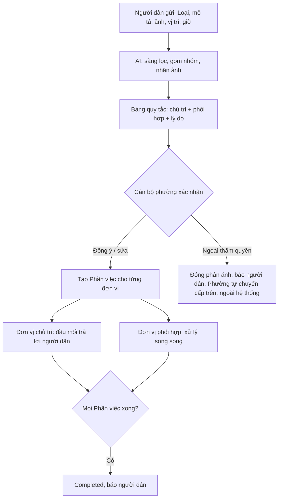

# Đề xuất phân luồng phản ánh môi trường tới đơn vị xử lý (29/10/2026)

Căn cứ: [research phòng ban UBND phường](research/domain-phong-ban-ubnd-phuong-hoa-xuan-2026-10-29/research.md) (gọi tắt là R), quyết định 4, 5 và mục 5 trong [chot-2026-10-29.md](chot-2026-10-29.md).
Đây là đề xuất của nhóm. Mọi dòng có nhãn `[GIẢ ĐỊNH]` cần phường xác nhận (câu hỏi ở R §7).

## 1. Nguyên tắc

1. **Bảng quy tắc, không huấn luyện model.** Đầu vào là Loại phản ánh, nhãn ảnh mà AI đã có (rác, thoát nước; quyết định 4), từ khóa trong mô tả và giờ gửi. Đầu ra là gợi ý: một đơn vị chủ trì và không hoặc nhiều đơn vị phối hợp. Lý do: chỉ có khoảng 100 phản ánh/tháng (quyết định 10), không có dữ liệu để huấn luyện, và theo Nghị định 150 cả 5 nhóm đều thuộc một phòng chủ trì (R §6).
2. **AI chỉ gợi ý.** Cán bộ phường xác nhận hoặc sửa trước khi tạo Phần việc. Lý do gợi ý được hiển thị kèm (ví dụ "từ khóa: karaoke; gửi lúc 23:10").
3. **Danh mục đơn vị và bảng quy tắc nằm trong cấu hình**, Admin sửa được. Lý do: Nghị định 370 cho thành phố đổi số và tên phòng từ 2026; Trạm Y tế mới về phường từ 01/7/2026 (R §1, §3).
4. **Một đơn vị chủ trì, phối hợp song song.** Mỗi đơn vị nhận một Phần việc có trạng thái riêng; phản ánh Completed khi mọi Phần việc xong (mục 5 của file chốt). Đơn vị chủ trì là đầu mối trả lời người dân (khớp câu 8 trong danh sách hỏi anh Tài).
5. **Phân luồng chỉ trong phường.** WRMS chỉ tiếp nhận và điều phối cho các đơn vị ở phường. Việc vượt thẩm quyền phường do phường tự chuyển lên cấp trên, ngoài hệ thống. WRMS không chuyển phản ánh ra ngoài, không lưu phiếu chuyển hay mã tiếp nhận, và không theo dõi kết quả ở cấp trên. Cán bộ phường chỉ đóng phản ánh với lý do "Ngoài thẩm quyền", kèm ghi chú tự do (không bắt buộc), và hệ thống báo người dân (quyết định 2 trong file chốt; người dùng xác nhận 29/10/2026).

## 2. Danh mục đơn vị (cấu hình mặc định)

| Mã | Đơn vị | Thuộc UBND? | Nhận việc qua hệ thống? |
| --- | --- | --- | --- |
| `KTHTDT` | Phòng Kinh tế, Hạ tầng và Đô thị | Có | Có |
| `VHXH` | Phòng Văn hóa - Xã hội | Có | Có |
| `TTCU` | Trung tâm Cung ứng dịch vụ sự nghiệp công | Có (đơn vị sự nghiệp) | Có `[GIẢ ĐỊNH]` |
| `TYT` | Trạm Y tế phường | Có (từ 01/7/2026) | Có `[GIẢ ĐỊNH]` |
| `CA` | Công an phường | **Không** (ngành dọc) | Mặc định **không**: Phần việc ở chế độ "chuyển thông tin", cán bộ phường ghi lại kết quả công an báo. Bật được nếu công an đồng ý dùng (câu 5 hỏi anh Tài) |

Văn phòng HĐND và UBND không nhận phản ánh môi trường. Văn phòng chỉ xử lý khi phản ánh chuyển thành khiếu nại, và việc này nằm ngoài WRMS.

## 3. Bảng quy tắc

Đơn vị chủ trì mặc định của cả 5 nhóm là `KTHTDT` (R §2.2, §6). Bảng dưới chỉ ghi các trường hợp **thêm** phối hợp.

| Nhóm | Loại phản ánh (đề xuất) | Thêm phối hợp khi | Đơn vị phối hợp |
| --- | --- | --- | --- |
| Rác và vệ sinh môi trường | Rác tồn đọng; Đổ rác, xà bần trái phép; Điểm tập kết rác quá tải; Xác động vật | Luôn luôn (người đi hiện trường) `[GIẢ ĐỊNH]` | `TTCU` |
| | | Cờ chất thải nguy hại, hoặc từ khóa: *kim tiêm, bông băng, thuốc, y tế* | `TYT` |
| | | Từ khóa: *xe tải đổ, đổ trộm, ban đêm, biển số* | `CA` |
| Ô nhiễm nguồn nước | Nước thải xả ra kênh, mương; Nước sông, hồ đổi màu, cá chết; Nước sinh hoạt có mùi, màu lạ | Loại "Nước sinh hoạt…", hoặc từ khóa: *giếng, nước máy, tiêu chảy, đau bụng* | `TYT`, `VHXH` |
| Không khí và mùi hôi | Đốt rác, đốt rơm; Khói, bụi từ cơ sở sản xuất; Mùi hôi từ chăn nuôi, bãi rác | Loại "Đốt rác…" | `CA` |
| | | Từ khóa: *khó thở, ho, ngất* | `TYT` |
| Tiếng ồn | Karaoke, loa kéo; Công trình xây dựng; Cơ sở sản xuất, kinh doanh | Gửi trong khung giờ đêm (mặc định 22:00 đến 06:00, cấu hình được) `[GIẢ ĐỊNH]` | `CA` |
| | | Loại "Karaoke, loa kéo" | `VHXH` (quản lý karaoke, cơ sở văn hóa) |
| Thoát nước và vệ sinh khu dân cư | Cống, mương tắc; Ngập đọng sau mưa; Nắp cống hỏng, mất | Luôn luôn `[GIẢ ĐỊNH]` | `TTCU` |
| | | Ngập kèm từ khóa: *muỗi, sốt xuất huyết* | `TYT` |

Ghi chú:

- Từ khóa được so trên mô tả đã bỏ dấu, viết thường. Danh sách từ khóa đặt trong cấu hình.
- Nhãn ảnh của AI (rác, thoát nước) dùng để **gợi ý sửa Loại phản ánh** khi người dân chọn sai loại, rồi bảng quy tắc chạy lại. Nhãn ảnh không trực tiếp chọn đơn vị.
- Phản ánh không khớp quy tắc nào thì chỉ đi `KTHTDT`. Không có trường hợp "không biết gửi đâu".

## 4. Luồng xử lý

## 5. Đo hiệu quả (cho phần nghiên cứu)

- **Tỷ lệ cán bộ phường giữ nguyên gợi ý**, tính riêng đơn vị chủ trì và đơn vị phối hợp. Hệ thống lưu cả gợi ý lẫn quyết định cuối nên đo được mà không cần gán nhãn thêm.
- **Baseline:** chỉ đi `KTHTDT`. Nếu bảng quy tắc không hơn baseline rõ rệt, báo cáo nói thật: ở cấp phường, phân luồng theo phòng ít giá trị, và giá trị nằm ở việc chọn người phụ trách trong phòng.

## 6. Cách làm lười hơn

Bỏ bảng quy tắc. Cán bộ phường tự tích chọn đơn vị phối hợp từ danh mục, còn đơn vị chủ trì luôn là `KTHTDT`. Cách này tốn ít công nhất, nhưng mất tính năng "AI phân luồng" mà phường yêu cầu (quyết định 5). Nên giữ bảng quy tắc vì công làm nhỏ: một bảng cấu hình cộng một hàm so khớp.

## 7. Cần phường xác nhận

Đã đưa vào PRD ngày 30/10/2026: FR-5 (Đơn vị xử lý), FR-23 (Hạn chót mặc định), FR-56 (đóng ngoài thẩm quyền), FR-57 (bảng quy tắc), FR-58 (gợi ý, xác nhận), FR-59 (phối hợp ngoài hệ thống), SM-R6. Câu hỏi dưới đây có ở PRD §14 câu 24 và `chot-2026-10-29.md` câu 13, 14.

1. `TTCU` có cử người đi hiện trường cho rác và cống không, hay `KTHTDT` tự làm? Nếu không cử, bỏ dòng "Luôn luôn".
2. Trạm Y tế có nhận việc qua hệ thống không?
3. Công an phường có dùng hệ thống không? Khung giờ đêm cho tiếng ồn là mấy giờ?
4. Trong `KTHTDT`, phản ánh vào tay ai (Trưởng phòng phân việc, hay giao thẳng công chức môi trường)? Nếu giao thẳng, thêm cột "người phụ trách mặc định theo Loại phản ánh" vào bảng ở §3.
